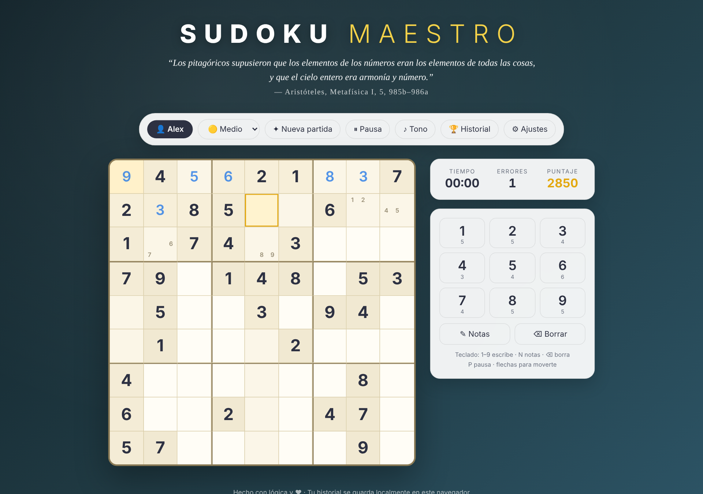
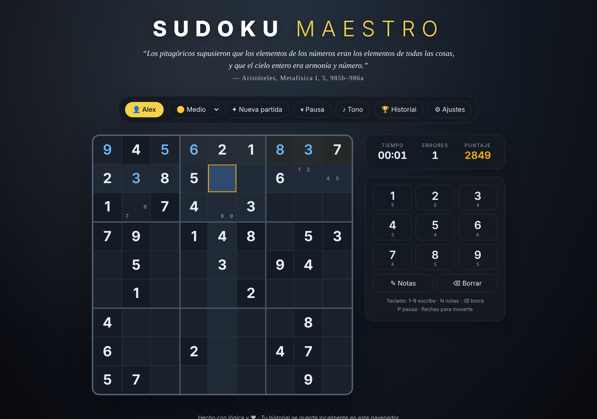
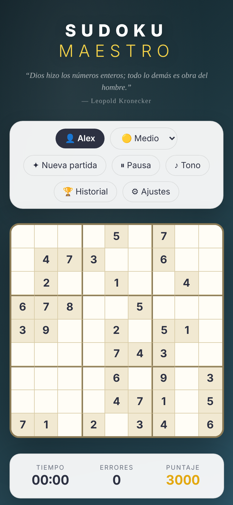

# Sudoku Maestro

**[Español](#español) · [English](#english)**



---

## Español

> *El arte de los patrones, una celda a la vez.*

**Sudoku Maestro** es un juego de sudoku para el navegador, contenido en un solo archivo HTML, sin dependencias, sin servidor y sin instalación. Genera un tablero nuevo en cada partida, lleva el registro de tus puntajes y en cada partida te recibe con una cita sobre la naturaleza de los números, de Platón y Aristóteles a Gauss y Hardy.

### ▶ Jugar

Abre `index.html` en cualquier navegador moderno o juega en línea en GitHub Pages:
`https://<tu-usuario>.github.io/sudoku-maestro/`

### Características

- **Tableros infinitos con solución única.** Cada partida se genera en el momento, nunca se repite un tablero predefinido.
- **Tres dificultades:** Fácil (42 pistas), Medio (34) y Difícil (27).
- **Modo notas** para anotar candidatos en cada celda. Las notas se limpian solas cuando colocas un número correcto en la misma fila, columna o caja.
- **Ayudas visuales:** resalta la fila, la columna y la caja de la celda activa y todas las apariciones del mismo número, y destella cuando completas una unidad.
- **Puntaje** basado en dificultad, tiempo y errores, con historial local por jugador y récord personal.
- **Tres temas** (Clásico, Nocturno, Minimal), ocho fondos y un color personalizable para tus números.
- **Tonos binaurales** opcionales generados con Web Audio (requieren audífonos estéreo).
- **Diseño adaptable** para escritorio y móvil.

### Controles

| Tecla | Acción |
|---|---|
| `1`–`9` | Escribir número |
| `N` | Activar/desactivar notas |
| `Backspace` / `Supr` | Borrar |
| `P` | Pausa |
| Flechas | Moverse por el tablero |

### Cómo se calcula el puntaje

```
puntaje = base − (segundos × factor de tiempo) − (errores × 150)    (mínimo 100)
```

| Dificultad | Base | Factor de tiempo |
|---|---|---|
| Fácil | 1 500 | 1.0 |
| Medio | 3 000 | 1.5 |
| Difícil | 5 000 | 2.0 |

### El algoritmo

El generador trabaja en dos fases:

1. **Construir una solución completa.** Llena la cuadrícula de 9 × 9 con *backtracking*. En cada paso elige la celda vacía con **menos candidatos posibles** (la heurística MRV, *minimum remaining values*) y prueba esos candidatos en orden aleatorio. Gracias a esta heurística, el árbol de búsqueda se poda casi por completo y la cuadrícula se llena en milisegundos.
2. **Quitar pistas sin perder la unicidad.** Recorre las 81 celdas en orden aleatorio y vacía cada una de manera tentativa. Un *solver* cuenta las soluciones y se detiene en cuanto encuentra dos. Si el tablero deja de tener una sola solución, la pista se restaura. El proceso termina al llegar al número de pistas de la dificultad elegida.

Así, cada tablero tiene **exactamente una solución**, que es la condición de un sudoku bien formado. En pruebas con 120 tableros, el 100 % fueron únicos y válidos, y ninguno tardó más de 70 ms en generarse.

> **Nota:** la dificultad se define por el número de pistas, no por las técnicas lógicas que exige el tablero. Por eso, dos tableros del mismo nivel pueden sentirse distintos.

### Privacidad

Todo ocurre en tu navegador. El historial, los jugadores y los ajustes se guardan en `localStorage` y nunca salen de tu equipo.

### Tecnología

HTML, CSS y JavaScript sin frameworks, más la Web Audio API y Canvas para el confeti. Un solo archivo de unos 44 KB.

### Capturas

| Tema Nocturno | Victoria | Móvil |
|---|---|---|
|  |  |  |

### Licencia

[MIT](LICENSE) © 2026 Alejandro Vázquez

---

## English

> *The art of patterns, one cell at a time.*

**Sudoku Maestro** is a browser-based sudoku game packed into a single HTML file: no dependencies, no server, no install. It generates a fresh puzzle every game, keeps track of your scores, and greets each game with a quote on the nature of numbers, from Plato and Aristotle to Gauss and Hardy. The interface is in Spanish.

### ▶ Play

Open `index.html` in any modern browser, or play online via GitHub Pages:
`https://<your-username>.github.io/sudoku-maestro/`

### Features

- **Endless puzzles with a unique solution.** Every board is generated on the fly; there are no predefined puzzles.
- **Three difficulty levels:** Easy (42 clues), Medium (34), Hard (27).
- **Notes mode** for pencil-marking candidates. Notes clear automatically when you place a correct number in the same row, column, or box.
- **Visual aids:** highlights the active row, column, and box, plus every instance of the same digit, and flashes when you complete a unit.
- **Scoring** based on difficulty, time, and mistakes, with a local per-player history and personal best.
- **Three themes** (Classic, Night, Minimal), eight backgrounds, and a customizable color for your digits.
- Optional **binaural tones** generated with Web Audio (stereo headphones required).
- **Responsive layout** for desktop and mobile.

### Controls

| Key | Action |
|---|---|
| `1`–`9` | Enter digit |
| `N` | Toggle notes mode |
| `Backspace` / `Delete` | Erase |
| `P` | Pause |
| Arrow keys | Move around the board |

### Scoring

```
score = base − (seconds × time factor) − (mistakes × 150)    (minimum 100)
```

| Difficulty | Base | Time factor |
|---|---|---|
| Easy | 1,500 | 1.0 |
| Medium | 3,000 | 1.5 |
| Hard | 5,000 | 2.0 |

### The algorithm

The generator works in two phases:

1. **Build a full solution.** It fills the 9 × 9 grid by backtracking. At each step it picks the empty cell with the **fewest remaining candidates** (the MRV heuristic) and tries those candidates in random order. The heuristic prunes the search tree so aggressively that the grid fills in milliseconds.
2. **Remove clues without losing uniqueness.** It visits all 81 cells in random order and tentatively blanks each one. A solver counts solutions and stops as soon as it finds two. If the puzzle no longer has exactly one solution, the clue is restored. The process stops once the target clue count for the chosen difficulty is reached.

Every puzzle therefore has **exactly one solution**, which is what makes a sudoku well-formed. In a test run of 120 puzzles, 100% were unique and valid, and none took more than 70 ms to generate.

> **Note:** difficulty is set by clue count, not by the logical techniques a puzzle requires, so two puzzles at the same level can feel different.

### Privacy

Everything runs in your browser. History, players, and settings are stored in `localStorage` and never leave your device.

### Tech

Vanilla HTML, CSS, and JavaScript, plus the Web Audio API and Canvas for the confetti. One file, about 44 KB.

### License

[MIT](LICENSE) © 2026 Alejandro Vázquez
